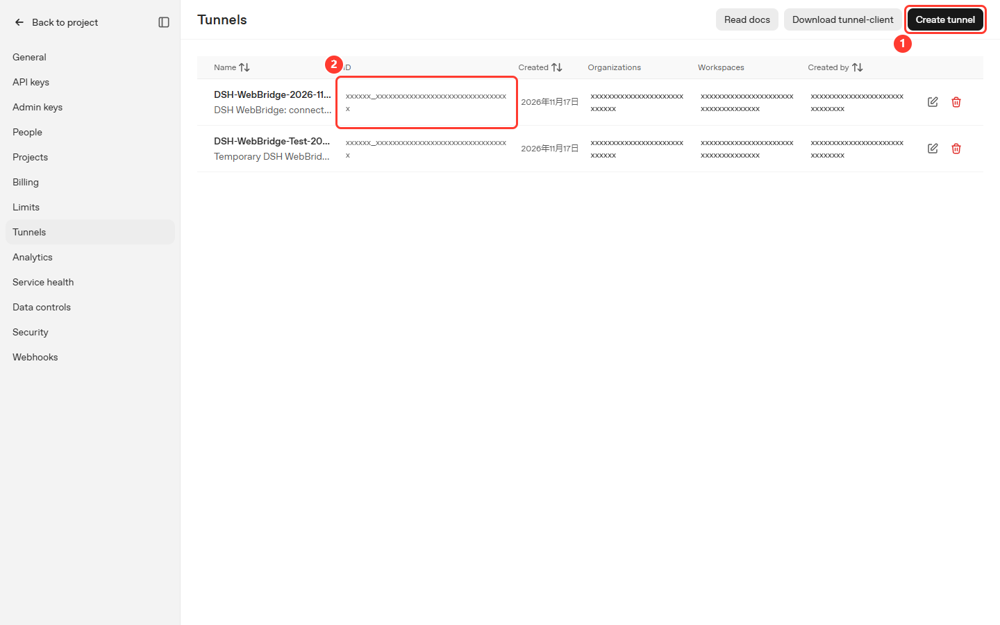
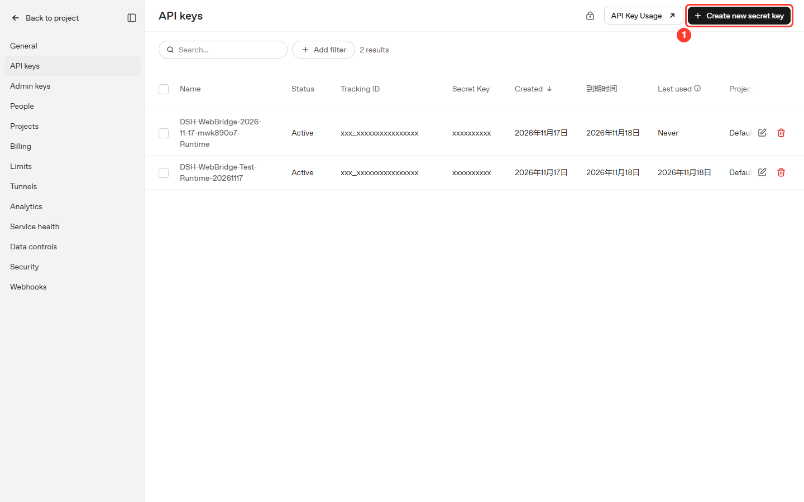
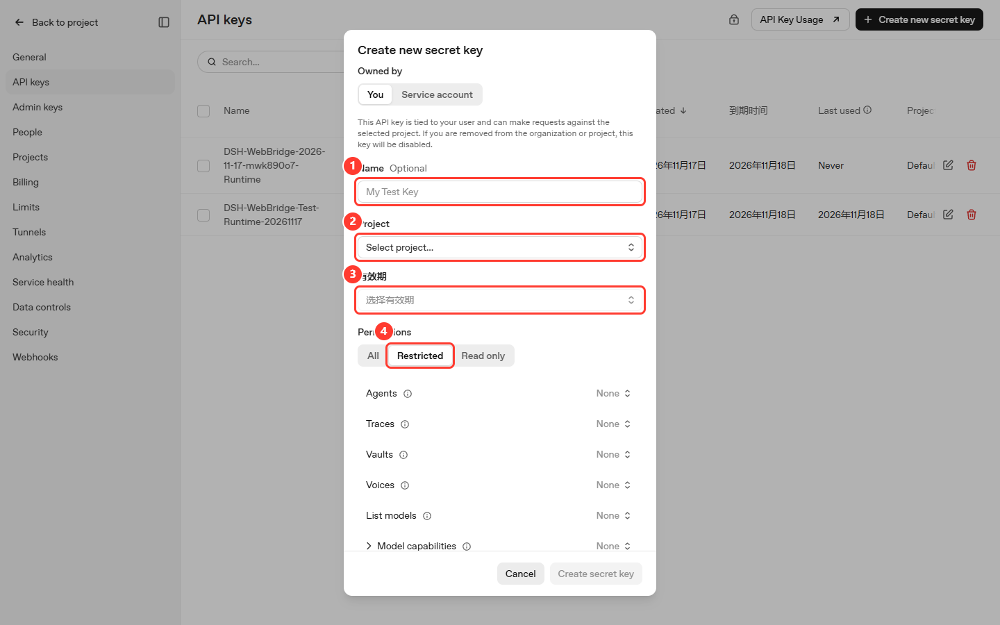
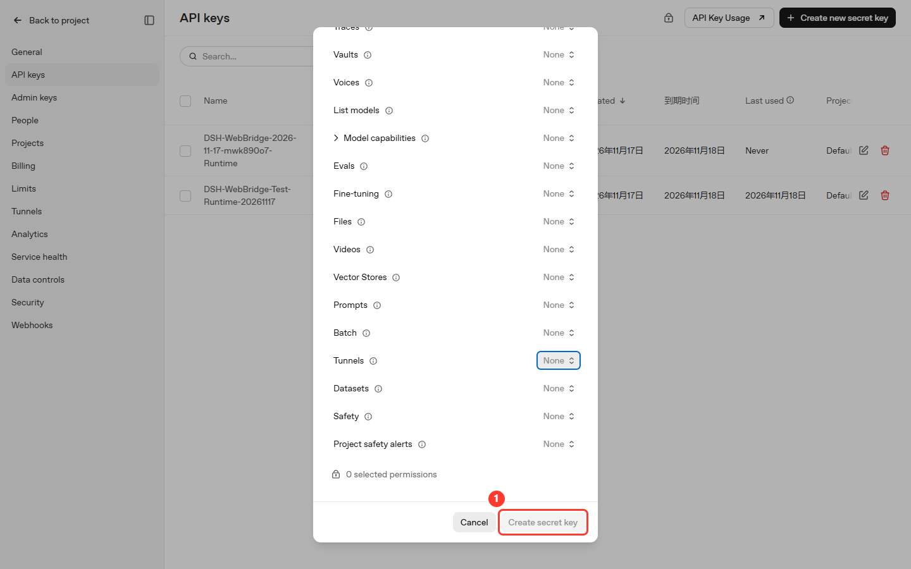
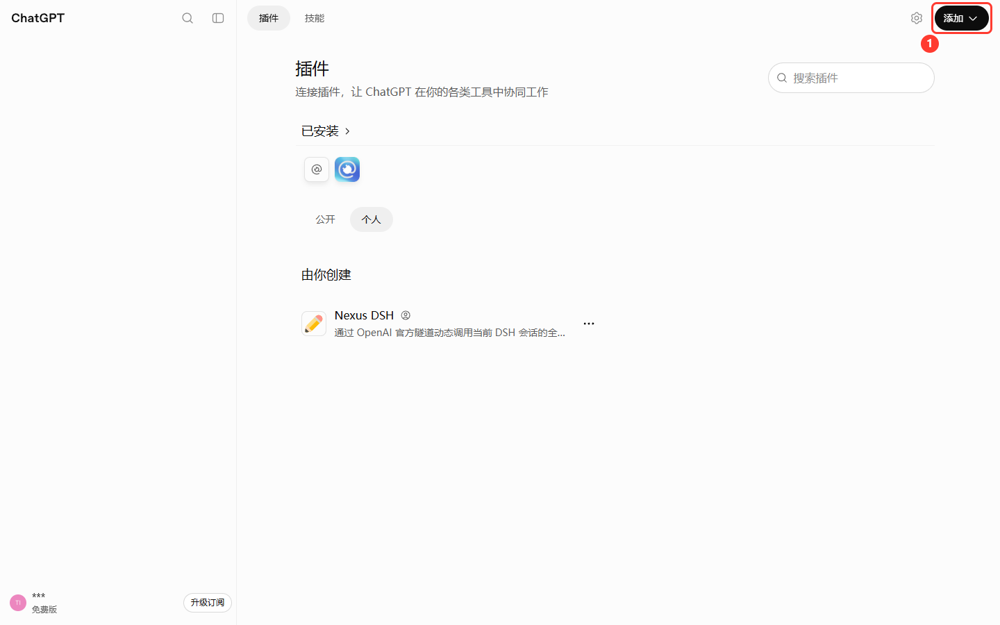
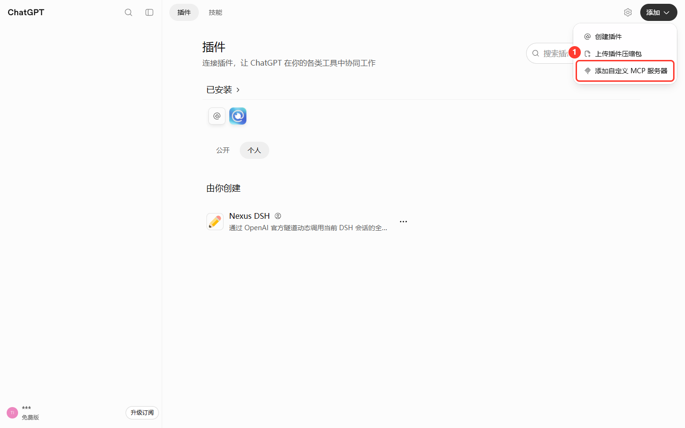
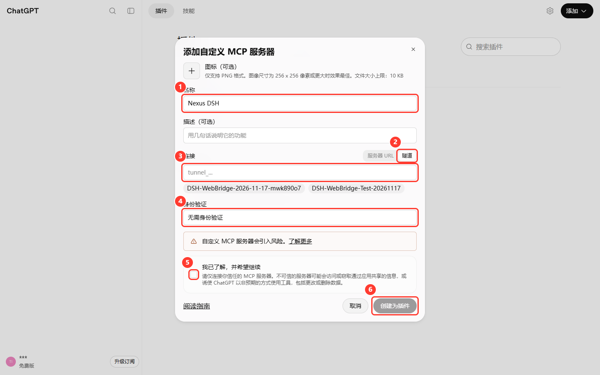
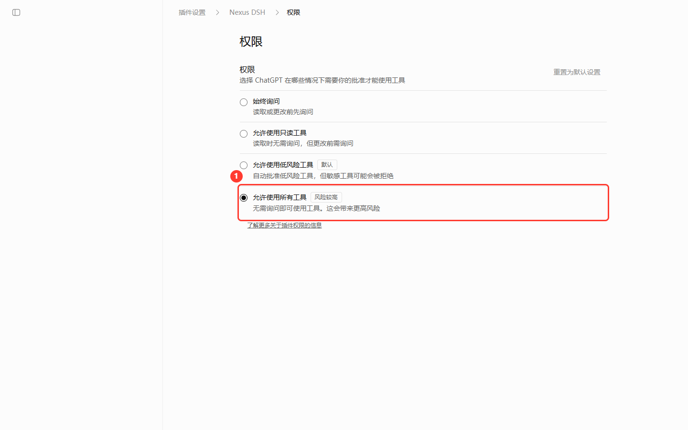

# 如何获取渠道与 API Key

DSH 的「设置 → ChatGPT 网页版」只需要两串值：

| 设置项 | 填写内容 | 来源 |
| --- | --- | --- |
| 渠道（Tunnel ID） | `tunnel_…` | OpenAI 控制台创建的 Secure MCP Tunnel |
| API Key（Runtime API Key） | `sk-…` | 在 OpenAI 控制台为这条隧道创建的 Runtime API Key |

隧道、密钥和 ChatGPT 网页插件都由你自行创建；插件只用这两串值连接并检测 MCP 是否可达。截图中的 ID、密钥与账号名均已打码。

## 第一步：创建隧道，拿到 Tunnel ID

1. 打开 <https://platform.openai.com/settings/organization/tunnels>，登录 OpenAI 账号；
2. 点红框 ① 的 **Create tunnel**，名称随意（如 `DSH-WebBridge-2026-11`），提交；
3. 复制红框 ② 单元格里的 **Tunnel ID**（`tunnel_…`），这就是「渠道」。

## 第二步：创建 Runtime API Key

1. 打开 <https://platform.openai.com/settings/organization/api-keys>，点红框 ① 的 **Create new secret key**。

2. 弹窗里按红框填写：① Name 随意；② Project 保持默认；③ 有效期选 **Never**；④ Permissions 选 **Restricted**。

3. 向下找到 **Tunnels** 行（红框 ①），点它右侧的 **None** 下拉，只勾 **Read**（①）和 **Use**（②）。

4. 点底部红框 ① 的 **Create secret key** 提交，弹窗里的 `sk-…` **立即复制保存——关掉就再也看不到完整密钥了**。

## 第三步：在 ChatGPT 网页里创建 WebBridge DSH 插件

1. 登录 <https://chatgpt.com>，打开 <https://chatgpt.com/plugins>，点红框 ① 的 **添加**。

2. 在菜单里选红框 ① 的 **添加自定义 MCP 服务器**。

3. 表单按红框填写：① 名称 `WebBridge DSH`；② 连接方式选 **Tunnel**；③ 在 `tunnel_...` 输入框粘贴第一步的 Tunnel ID；④ 认证方式选 **无需身份验证**；⑤ 勾选信任确认框；⑥ 点创建提交，随后在确认弹窗里点 **WebBridge DSH** 完成连接。

4. 打开该插件的权限页，选红框 ① 的 **允许使用所有工具**。

## 第四步：填进 DSH 设置，开始使用

1. 打开「设置 → ChatGPT 网页版」；
2. 「渠道（Tunnel ID）」粘贴 `tunnel_…`，「API Key（Runtime API Key）」粘贴 `sk-…`；
3. 点 **保存并连接**：插件把两串值加密保存在本机，启动官方隧道并检测 MCP 连接，不会在网页里创建或修改任何内容；
4. 状态显示「已连接」后，在 DSH 会话里选择「ChatGPT 网页版」模型即可开始使用。
