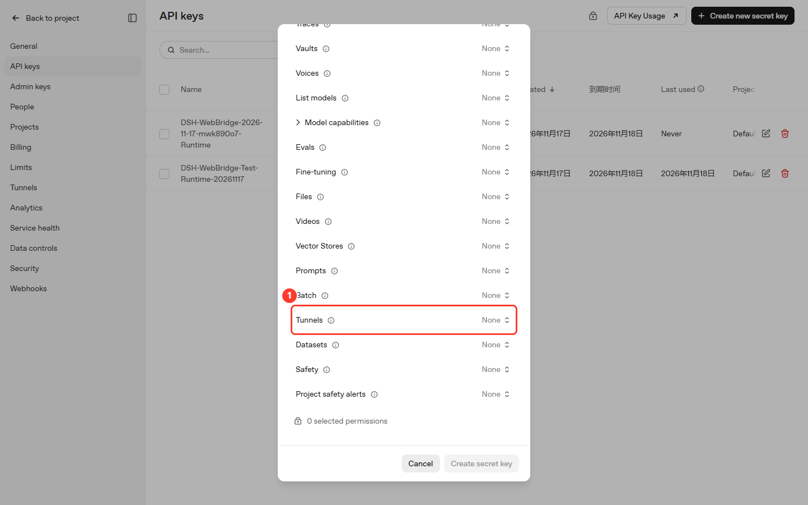
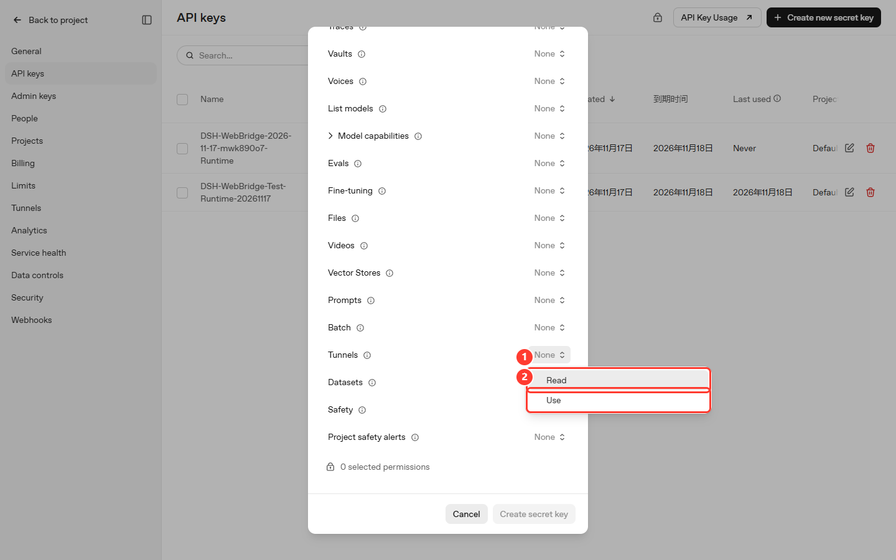

# 如何获取渠道与 API Key

DSH 的「设置 → ChatGPT 网页版」里只需要填两样东西：

| 设置项 | 填写内容 | 来源 |
| --- | --- | --- |
| 渠道（Tunnel ID） | `tunnel_…` 开头的一串 ID | 在 OpenAI 控制台创建的 Secure MCP Tunnel |
| API Key（Runtime API Key） | `sk-…` 开头的密钥 | 在 OpenAI 控制台为这条隧道创建的 Runtime API Key |

插件不会代替你申请隧道和密钥，也不会登录 OpenAI 控制台。按下面三步自己创建一次，之后把两串值填进设置页即可；密钥会加密保存在本机，不需要每次重填。

> 下文截图里的 Tunnel ID、组织/工作区 ID、Tracking ID、Secret Key、创建人等敏感字段均已打码；红框 + 数字标出了需要点击或复制的地方。

## 第零步：安装 DSH-WebBridge 插件

1. 安装 Node.js 22+ 和 Google Chrome。
2. 克隆本仓库，在项目目录执行：

   ```powershell
   npm ci
   npm run build:client
   ```

3. 在 DSH 中加载插件：
   - 桌面版：打开「设置 → 插件 → 添加插件」，选择本项目目录 `DSH-WebBridge`；
   - 或使用安装包自带命令（macOS 桌面版示例）：

     ```sh
     "/Applications/DeepSeek Harness.app/Contents/Resources/runtime/cli/bin/dsh" plugin --profile desktop add "$PWD"
     ```

4. 打开「设置 → ChatGPT 网页版」，点「登录网页版」，在 WebBridge 自己的 Chrome 窗口中手动完成 ChatGPT 登录。账号登录、验证码、人机验证始终由你本人完成。

## 第一步：创建隧道，拿到 Tunnel ID

1. 用浏览器打开 <https://platform.openai.com/settings/organization/tunnels>，登录 OpenAI 平台账号。
2. 点右上角红框 ① 的 **Create tunnel**。
3. 填写表单：
   - **Name**：起一个能认出的名字，例如 `DSH-WebBridge-2026-11`；
   - **Description**：随便写，例如 `Connect ChatGPT to this device through an OpenAI Secure MCP Tunnel.`；
   - **Workspace**：只有一个工作区时保持默认；有多个时选你平时用的那个（要和 DSH「高级设置」里的工作区 ID 一致）。
4. 提交后回到隧道列表，复制红框 ② 单元格里的 **Tunnel ID**（形如 `tunnel_abcdef1234567890`）。这就是设置页里的「渠道」。


> 一条隧道可以长期复用。以后换电脑或重装插件都不用重建，只要还在同一个组织里。Tunnel 是 OpenAI 官方提供的出站连接：本机主动连到 OpenAI，不需要公网 IP、域名或开放入站端口。

## 第二步：为这条隧道创建 Runtime API Key

1. 打开 <https://platform.openai.com/settings/organization/api-keys>，点红框 ① 的 **Create new secret key**。


2. 在弹出的创建表单里依次填写：

   | 红框 | 表单项 | 填写 |
   | --- | --- | --- |
   | ① | Name | 例如 `DSH-WebBridge-Runtime`（可选） |
   | ② | Project | 默认的 `Default project`（或你在 DSH「高级设置」里填的项目名） |
   | ③ | 有效期 | **Never**（永不过期）。只想试用可以选 1 day，过期后要重新创建 |
   | ④ | Permissions | 选 **Restricted**（受限） |

   

3. 表单下方展开权限范围列表，向下滚动找到 **Tunnels** 行（红框 ①），点它右侧的 **None** 下拉：

   

4. 在下拉选项中只勾选红框 ① 的 **Read** 和红框 ② 的 **Use**，其他都不选：

   

   > 这个 Key 只需要 Tunnels 的 Read、Use 两项权限，不要给更大的范围。它和 ChatGPT 网页里「插件允许使用哪些工具」是两套完全不同的权限。

5. 滚动到表单底部，点红框 ① 的 **Create secret key** 提交。

   

6. 提交后弹窗里会显示一次完整密钥（形如 `sk-proj-xxxx…`），**立即复制保存——弹窗关掉以后就再也看不到完整密钥了**，控制台里只会显示前缀和名称。

## 第三步：填进 DSH 设置页

1. 打开「设置 → ChatGPT 网页版 → 概览」。
2. 在「渠道（Tunnel ID）」里粘贴 `tunnel_…`。
3. 在「API Key（Runtime API Key）」里粘贴 `sk-…`。
4. 点 **保存并连接**。

接下来的动作由插件自动完成：

- 用这两串值启动官方 `tunnel-client`，经由 OpenAI 隧道把本机 MCP 暴露给 ChatGPT；
- 首次连接时自动创建（或复用）ChatGPT 网页里的 **Nexus DSH** 插件，详见下面第四步；
- 之后每一轮聊天里，网页模型通过 `dsh_get_context` 读取 DSH 的完整上下文，并调用当前会话可用的工具。

连接成功后状态显示「已连接」。「高级设置」里可以打开「断线自动重连」，DSH 下次启动会自动恢复隧道。

## 第四步：创建 ChatGPT 网页插件（Nexus DSH）

ChatGPT 是通过网页里的 MCP 插件调用你本机 DSH 工具的。这个插件名叫 **Nexus DSH**，连接的就是第一步创建的那条 Tunnel。

### 默认：首次「保存并连接」时自动创建

在完成「第零步」的**登录网页版**之后再点「保存并连接」，WebBridge 会自动：

1. 在 <https://chatgpt.com/plugins> 创建名为 **Nexus DSH** 的自定义 MCP 插件：连接方式选 OpenAI Tunnel、填当前 Tunnel ID、认证方式选 NONE、勾选信任本机 MCP；
2. 打开它的权限设置，选「允许使用所有工具」（full_access）；
3. 刷新工具目录，把当前 DSH 会话可用的全部工具（含 `dsh_get_context`）同步给 ChatGPT。

已存在同名插件时不会重复创建：先核对它连接的是不是当前 Tunnel ID，一致才复用。发现多个同名、或无法确认属于当前隧道时会自动停下，这时按下面的手动步骤处理。

### 手动核查

1. 打开 <https://chatgpt.com/plugins>，确认列表里有 **Nexus DSH**；
2. 打开它的设置页，确认连接的 Tunnel ID 与「渠道」里填的一致；
3. 打开权限页，确认是「允许使用所有工具」；
4. 回到管理页点「刷新工具」，工具数量应与 DSH 当前可用工具数一致。

### 手动创建（自动安装失败或插件丢失时）

1. 登录 <https://chatgpt.com>，打开插件目录，新建一个「自定义 MCP 连接器」；
2. 名称填 `Nexus DSH`，说明随意，例如「通过 OpenAI 官方隧道动态调用当前 DSH 会话的全部可用工具。」；
3. 连接方式选择 **OpenAI Tunnel**（不要选 URL 直连方式），在 `tunnel_...` 输入框里粘贴你的 Tunnel ID；
4. 认证方式下拉选 **NONE**；
5. 勾选「信任本机 MCP」确认框，提交；
6. 在确认弹窗里点击名称为 Nexus DSH 的按钮完成连接；
7. 打开这个插件的权限设置，选「允许使用所有工具」；
8. 回到管理页点「刷新工具」，确认能看到 `dsh_get_context` 等 DSH 工具。

> 不要创建多个同名 Nexus DSH 插件，网页模型会分不清该用哪一个；同一台机器、同一条隧道只需要一个。删掉不用的旧插件后再重新连接。

## 密钥保存在哪里

- Windows：`~/.dsh/webbridge/tunnel-config.enc`，用当前用户 DPAPI 加密，换用户或换机器无法解密。
- macOS：登录钥匙串里服务名 `DSH WebBridge` 的条目，首次读取可能要求解锁钥匙串。
- 设置页只显示「已安全保存」，不会再回显明文；输入框留空表示保留现有值。

明文密钥不会写进日志、命令行参数或设置页状态；请同样不要把它提交到 Git、粘贴到 Issue 或发给别人。

## 常见问题

**连接失败，提示密钥无效或 401**
密钥复制不完整，或权限不含 Tunnels 的 Read、Use。回控制台确认这条 Key 的权限（见第二步第 3–4 条），必要时新建一把再填一次。

**提示没有权限访问隧道**
Key 与隧道不在同一个组织/项目，或你的账号没有该组织的 Tunnel 权限。确认两者同属一个组织，并在「高级设置」里填对工作区 ID。

**Key 过期了**
选过 1 day 的试用 Key 到期后需要重新创建。正式使用建议选 Never。

**设置页显示「已连接」，但网页里没有工具**
在 ChatGPT 网页里打开 `设置 → 已连接的插件 → Nexus DSH`，确认连接的是当前 Tunnel ID，并且权限是「允许使用所有工具」。刚升级插件时，需要重载 DSH 插件并刷新一次工具元数据。

**公司网络要走代理**
「高级设置 → 隧道网络」选择跟随系统代理或自定义代理。代理只影响去 OpenAI 控制面的连接，本机 MCP 始终走回环地址。

**多人共用一台机器**
每个人用自己账号的 Tunnel 和 Key，并在系统里用各自的 Windows 用户登录；DPAPI 加密的配置按用户隔离。

## 相关链接

- OpenAI 隧道管理：<https://platform.openai.com/settings/organization/tunnels>
- OpenAI API Keys：<https://platform.openai.com/settings/organization/api-keys>
- ChatGPT 已连接插件：<https://chatgpt.com/plugins>
- 插件整体设置说明：[CHATGPT-SETUP.md](CHATGPT-SETUP.md)
